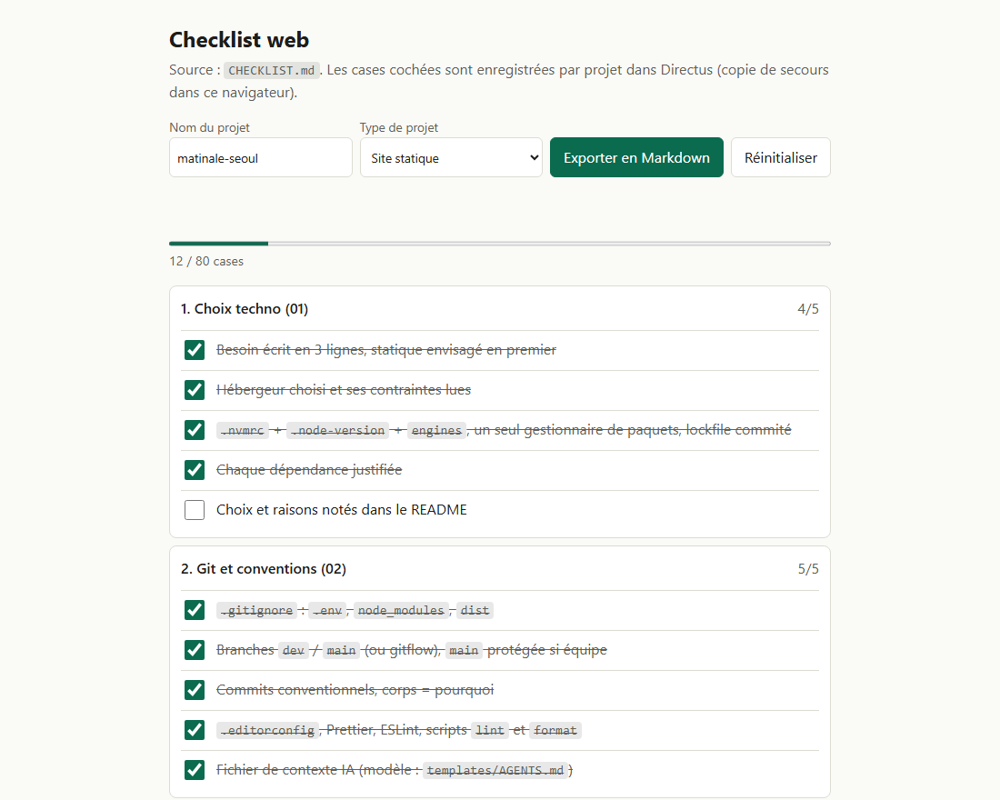
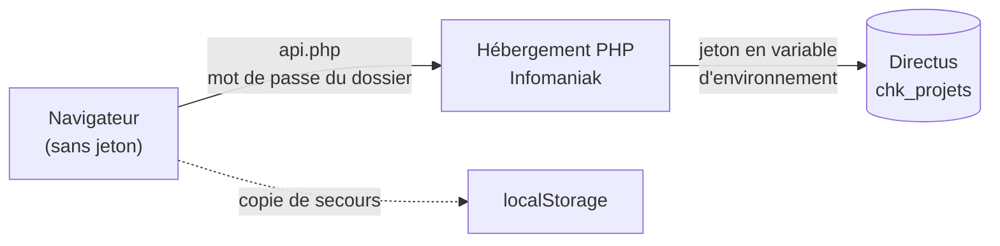

<div align="center">

# web-checklist

**Mes bonnes pratiques de développement web, à valider à chaque projet,<br>du choix de la techno jusqu'au SEO final.**

12 guides thématiques &middot; 99 cases à cocher &middot; une page de suivi accessible depuis n'importe quel poste

<picture>
  <source media="(prefers-color-scheme: dark)" srcset="docs/images/page-sombre.png">
  
</picture>

<sub>La page de suivi, avec des données d'exemple.</sub>

</div>

---

## En bref

Ce dépôt est né de ce que j'ai appris en construisant des projets depuis août 2026. Chaque leçon (une faille, un bug de déploiement, un choix regretté) est écrite une fois, avec l'exemple tiré de mon propre code, pour ne pas la refaire.

- **Des guides** : un fichier par thème, tous sur le même gabarit (pourquoi, règles, checklist, exemples avec le chemin du fichier source, commandes, pièges déjà vécus).
- **Une checklist condensée** : les 99 cases à copier dans un projet, filtrables par type (site statique, SPA + BaaS, SSR / API).
- **Une page de suivi** : on coche les cases par projet, l'état est enregistré dans Directus et se retrouve depuis n'importe quel poste.
- **Un modèle de fichier de contexte IA** : les règles d'or en moins de 60 lignes.

## Utilisation

| Moment | Fichiers à parcourir |
|---|---|
| **Démarrage** du projet | 01 techno, 02 git, 03 secrets, 08 CI/CD (mise en place du pipeline) |
| **Pendant** le développement | 04 sécurité, 06 base de données, 07 tests, 10 accessibilité |
| **Avant la mise en ligne** | 05 attaques extérieures, 09 performance, 11 SEO, 12 mise en production |
| **Maintenance** (chaque mois) | 05 chaîne d'approvisionnement, 12 suivi, `npm audit`, Dependabot |

1. Ouvrir la page de suivi, saisir le nom du projet et choisir son type. Ou copier [`CHECKLIST.md`](site/CHECKLIST.md) dans `doc/` du nouveau projet.
2. Cocher au fil de l'eau. Une case qu'on ne coche pas doit avoir une raison écrite à côté.
3. Quand une case n'est pas claire, ouvrir le guide numéroté correspondant.
4. À chaque incident ou découverte, ajouter la leçon dans le bon guide ici.

## Les guides

| Guide | Sujet |
|---|---|
| [01 Choix techno](guide/01-choix-techno.md) | Choisir framework, CMS, base et hébergeur |
| [02 Git et conventions](guide/02-git-et-conventions.md) | Branches, commits, formatage, lint |
| [03 Config et secrets](guide/03-config-et-secrets.md) | Variables d'environnement, jetons, moindre privilège |
| [04 Sécurité de l'app](guide/04-securite-app.md) | OWASP, en-têtes, CSP, auth, validation, contre-exemples |
| [05 Attaques extérieures](guide/05-attaques-exterieures.md) | Débit, bots, formulaires, chaîne d'approvisionnement |
| [06 Base de données](guide/06-base-de-donnees.md) | Droits, RLS, migrations, sauvegardes |
| [07 Tests](guide/07-tests.md) | Unitaires, e2e, tests du build, fuseaux horaires |
| [08 CI/CD et déploiement](guide/08-ci-cd-et-deploiement.md) | Pipeline, déploiement FTP sans risque |
| [09 Performance](guide/09-performance.md) | Images, cache, polices, JavaScript |
| [10 Accessibilité](guide/10-accessibilite.md) | Clavier, ARIA, mouvement réduit, sans JS |
| [11 SEO](guide/11-seo.md) | Balises, JSON-LD, sitemap, Search Console |
| [12 Mise en production et suivi](guide/12-mise-en-prod-et-suivi.md) | Jour J, suivi d'erreurs, légal, mises à jour |
| [Checklist condensée](site/CHECKLIST.md) | Toutes les cases à copier dans un projet |

## La page de suivi

`site/index.html` lit `CHECKLIST.md` et l'affiche en cases à cocher : filtre par type de projet, progression globale et par section, export en Markdown à coller dans `doc/CHECKLIST.md`. Aucune dépendance, aucun build.

L'état coché est enregistré par nom de projet. Le navigateur ne parle jamais à Directus : il passe par un petit proxy PHP qui garde le jeton côté serveur.



- **Hors ligne ou en local sans PHP** : la page continue de fonctionner, seul le navigateur sauvegarde.
- **Pas d'écrasement par erreur** : la page n'écrit dans Directus qu'après l'avoir lu pour le projet.
- **Moindre privilège** : le jeton ne peut que créer, lire et modifier la collection `chk_projets`, sans suppression.

### Déploiement

1. Créer le client `chk` dans Directus avec [`platform-cms`](https://github.com/Fbrend23/platform-cms) (`clients/checklist.json`, puis `npm run provision` et un utilisateur d'écriture).
2. Sur un hébergement web PHP (Infomaniak), déposer le contenu de `site/` : `index.html`, `CHECKLIST.md`, `api.php`.
3. Dans le Manager, onglet PHP / Apache des paramètres avancés du site, ajouter les variables d'environnement `DIRECTUS_URL` et `DIRECTUS_TOKEN`.
4. Activer la protection du dossier par mot de passe. Elle couvre aussi `api.php`, sans elle n'importe qui pourrait écrire dans la checklist.

### En local

```bash
# page seule, sauvegarde dans le navigateur
npx serve site

# page et synchro Directus
DIRECTUS_URL=https://api.example.ch DIRECTUS_TOKEN=... php -S 127.0.0.1:8099 -t site
```

`fetch` ne fonctionne pas en `file://`, il faut passer par un serveur.

## Modèle de règles pour l'assistant IA

[`templates/AGENTS.md`](templates/AGENTS.md) : les règles d'or en moins de 60 lignes, à copier à la racine d'un projet (le fichier de contexte doit rester sous 200 lignes).

## Structure

```
web-checklist/
  README.md
  guide/       12 guides thématiques (01 à 12)
  templates/   modèles à copier dans un projet (AGENTS.md)
  site/        ce qui se déploie : index.html, CHECKLIST.md, api.php
  docs/        images du README
```

## Principes qui reviennent partout

- **Rien ne doit réussir en silence** : une panne doit faire du bruit.
- **Le plus simple qui marche** : statique avant dynamique, natif avant dépendance.
- **Moindre privilège** : un jeton, un compte, un droit par usage.
- **Ne jamais faire confiance à l'entrée**, valider côté serveur.
- **Une seule source de vérité** pour chaque donnée ou règle.
- **Écrire la raison** d'un choix, surtout d'une absence (pas de CSP, pas de test).

## Projets cités en exemple

Cliffhanger-, matinale-seoul, Portail, Prodysos, LunchPicker, site-photos-v2, Maisallezfieu, mis.lawmission.net-V2, Contact, platform-cms, Wiki-ETML, ainsi que mes cours (183 sécurité des applications, CI/CD). Les chemins sont relatifs au dossier `GitHub/`. Les contre-exemples sont anonymisés : ils sont là pour apprendre, pas pour juger.

## Licence

[MIT](LICENSE).
